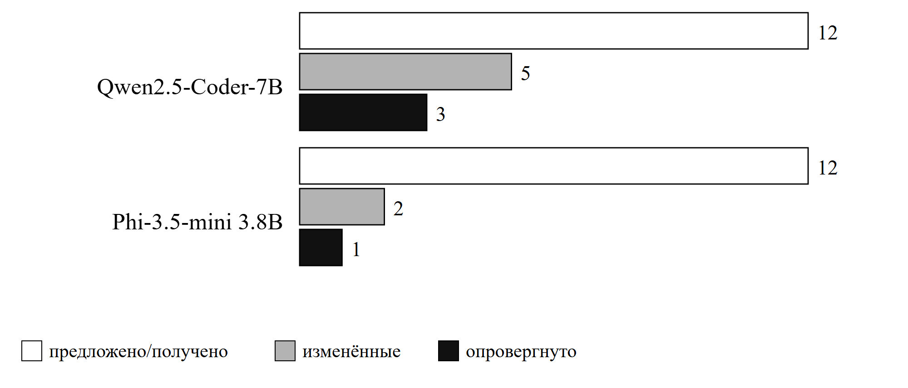
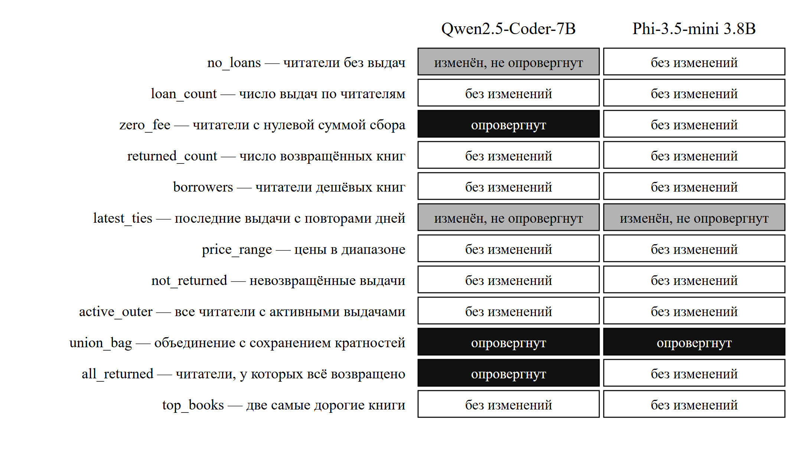
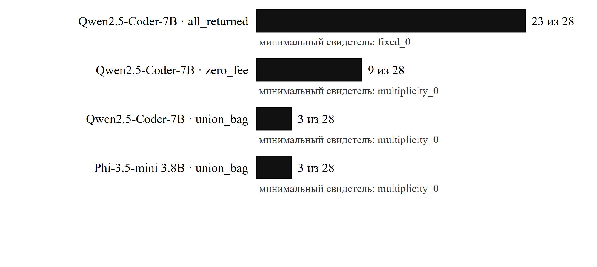

# Корпус «Библиотека»: Qwen2.5-Coder-7B против Phi-3.5-mini 3.8B

Сравнение двух локальных языковых моделей при переписывании SQL на заранее
зафиксированном корпусе. Настоящий документ содержит только выполненные
измерения; он не заменяет рукопись и не является отчётом о подаче.

Дата разбора: 15 октября 2026. Ответы моделей получены 15 октября 2026,
23:07–23:14 МСК. Оценка выполнена 15 октября 2026, 23:36 и 23:44 МСК.

## 1. Что именно измерялось

Вопрос опыта: **какие изменения результата предлагают две разные модели на
одинаковых задачах и какие состояния базы обнаруживают эти изменения?**

Опыт проверяет **только эквивалентность**. Скорость выполнения в этой серии не
измерялась ни разу: кандидаты исполнялись в изолированной схеме с ограничением
времени, а не в режиме повторных прогонов. Утверждения об ускорении к этим
данным не относятся.

| Параметр | Значение |
|---|---|
| Корпус | `research/library_v1/corpus.json` |
| SHA-256 корпуса | `ff7d02331e7c5a4b650eff35742bb7d466753e7a2ed51d59310a6e8c3581ca58` |
| Запросов | 12 синтетических, один дополнительный домен (библиотека) |
| Состояний базы | 28 на каждый запрос |
| Положительных контролей | 4 |
| Моделей | 2 |
| Ответов моделей | 24 (12 на модель), одно обращение на запрос |
| Проверок «запрос × состояние» | 672 |
| Температура / контекст / предел ответа | 0 / 4096 / 1200 токенов |
| Служба локальных моделей | Ollama 0.40.4 |
| Бюджет обращений | 49 израсходовано до серии, 26 в серии, 75 из 120 |

| Модель | Параметр | Квантование | Digest |
|---|---|---|---|
| Qwen2.5-Coder-7B | 7,6 млрд | Q4_K_M | `dae161e27b0e…4364` |
| Phi-3.5-mini | 3,8 млрд | Q4_0 | `61819fb370a3…d04ba` |

Корпус заморожен до получения ответов: preflight в CI исполнил 672 эталонных и
224 контрольных обращения к MySQL 8.4.11 и PostgreSQL 16.15, коммит и digest
образа зафиксированы. После начала сбора корпус не изменялся; изменение
потребовало бы новой версии.

## 2. Исходы по моделям

| Показатель | Qwen2.5-Coder-7B | Phi-3.5-mini 3.8B |
|---|---|---|
| Ответов получено | 12 из 12 | 12 из 12 |
| Предложено переписываний | 5 | 2 |
| Вернули запрос без изменений | 7 | 10 |
| **Опровергнуто** | **3** | **1** |
| Не опровергнуто на 28 состояниях | 9 | 11 |
| Проверок всего | 336 | 336 |
| Из них опровергнуто | 35 | 3 |
| Ошибок исполнения | 0 | 0 |
| Отличий интерфейса столбцов | 0 | 0 |
| Неподдерживаемый или неразобранный SQL | 0 | 0 |

Первое наблюдение: **более крупная специализированная по коду модель ошиблась
чаще, чем меньшая общего назначения** — 3 против 1. Она же предложила больше
переписываний: 5 против 2. Направление совпадает с прежними сериями на
GigaChat: чем чаще модель переписывает запрос, тем больше и удачных
преобразований, и ошибок. Готовность переписывать здесь прямо связана с риском
ошибки.

Второе наблюдение относится к дисциплине ответа. В служебной пробе 13 октября
Phi-3.5 выглядела хуже: ответ был усечён, формат не соблюдён. В полной серии
это не подтвердилось: все 24 ответа завершены штатно (`done_reason=stop`),
ни одного markdown-обрамления, ни одного расхождения интерфейса столбцов.
Проба ограничивала вывод 16 токенами намеренно, поэтому её результат
характеризует пробу, а не модель.

## 3. Разбор по запросам

Изменения предложены в 7 парах «модель × запрос», опровергнуто 4 из них.

| Запрос | Намерение | Qwen2.5-Coder-7B | Phi-3.5-mini 3.8B |
|---|---|---|---|
| `no_loans` | читатели без выдач | изменён, не опровергнут | без изменений |
| `loan_count` | число выдач по читателям | без изменений | без изменений |
| `zero_fee` | читатели с нулевой суммой сбора | **опровергнут** | без изменений |
| `returned_count` | число возвращённых книг | без изменений | без изменений |
| `borrowers` | читатели дешёвых книг | без изменений | без изменений |
| `latest_ties` | последние выдачи с повторами дней | изменён, не опровергнут | изменён, не опровергнут |
| `price_range` | цены в диапазоне | без изменений | без изменений |
| `not_returned` | невозвращённые выдачи | без изменений | без изменений |
| `active_outer` | все читатели с активными выдачами | без изменений | без изменений |
| `union_bag` | объединение с сохранением кратностей | **опровергнут** | **опровергнут** |
| `all_returned` | читатели, у которых всё возвращено | **опровергнут** | без изменений |
| `top_books` | две самые дорогие книги | без изменений | без изменений |

Оба неопровергнутых изменения `latest_ties` — коррелированный подзапрос,
заменённый соединением с `MAX(day_no)`. Повторы дней при этом сохраняются:
запрос отбирает все выдачи с максимальным днём, и соединение ведёт себя так же.

Изменение `no_loans` у Qwen — `NOT EXISTS`, заменённый на `NOT IN`. Оно прошло
28 состояний, но его безопасность обеспечена схемой: `lib_loans.reader_id`
объявлен `NOT NULL`. При допущении NULL в этом столбце `NOT IN` вернул бы пустой
результат. Это пример преобразования, которое нельзя считать безопасным без
учёта ограничений схемы; корпус допускает NULL только в `returned`.

## 4. Ошибки: механизм и обнаружившее состояние

| № | Модель | Запрос | Механизм ошибки | Опровергнуто состояний | Минимальный свидетель |
|---|---|---|---|---|---|
| 1 | Qwen2.5-Coder-7B | `all_returned` | Обращение условия: выбраны читатели с активной выдачей вместо читателей, у которых возвращено всё | **23 из 28** | `fixed_0` |
| 2 | Qwen2.5-Coder-7B | `zero_fee` | Агрегатное условие заменено построчным: «есть выдача с нулевым сбором» вместо «сумма сборов равна нулю» | 9 из 28 | `multiplicity_0` |
| 3 | Qwen2.5-Coder-7B | `union_bag` | `UNION ALL` заменён на `OR`: выдача, попадающая в оба условия, схлопывается в одну строку | 3 из 28 | `multiplicity_0` |
| 4 | Phi-3.5-mini 3.8B | `union_bag` | То же преобразование, тот же механизм, тот же свидетель | 3 из 28 | `multiplicity_0` |

**Ошибка 1 — самая грубая и самая заметная.** Исходный запрос отбирает
читателей, у которых есть хотя бы одна выдача и при этом нет ни одной
невозвращённой. Модель заменила это на «есть выдача с `returned=0`» — то есть
на противоположное по смыслу условие. Расхождение видно уже на простейшем
состоянии `fixed_0`: эталон возвращает `[1]`, кандидат `[2]`. Такое
преобразование обнаруживается немедленно и не требует продуманных граничных
профилей.

**Ошибка 2 — самая коварная.** Исходное условие — агрегатное:
`HAVING COALESCE(SUM(l.fee),0)=0`. Модель заменила его построчным
`WHERE l.fee IS NULL OR l.fee=0`. Читатель, у которого есть выдача с нулевым
сбором, но суммарно сбор не равен нулю, попадает в результат ошибочно. На
состоянии `multiplicity_0` у читателя 1 сборы равны 1, 0, 0, 1: построчное
условие выполняется, сумма равна 2 — эталон читателя 1 исключает, кандидат
включает. Эта ошибка **не видна на одиночной выдаче** и требует состояния с
несколькими выдачами на читателя.

**Ошибки 3 и 4 — совпадающие.** Обе модели независимо предложили одну и ту же
замену `UNION ALL` на `OR` и обе ошиблись на кратностях: выдача, для которой
одновременно `returned=0` и `fee=0`, в исходном запросе присутствует дважды, а
при `OR` — один раз. Эталон возвращает `[1,1,1,1]`, кандидат `[1,1,1]`.
Обнаруживают расхождение только состояния с повторами.

Практический вывод для методики: **совпадение двух независимых моделей не
является свидетельством корректности**. Две модели из двух предложили одно и то
же неверное преобразование, и обычная перекрёстная проверка «модели
согласились» пропустила бы эту ошибку.

## 5. Что обнаруживает ошибку

| Профиль состояния | Что проверяет | Обнаружил ошибок |
|---|---|---|
| `multiplicity_0` | несколько выдач на читателя, повторяющиеся строки | **4 из 4** |
| `ties_0` | равные ключи сортировки | **4 из 4** |
| `nullable_0` | NULL в допускающем NULL столбце | 3 из 4 |
| `zero_fee_0` | нулевой сбор | 2 из 4 |
| 20 псевдослучайных состояний | общее покрытие | 2 из 4 |
| `boundary_0` | включающие границы | 1 из 4 |
| `fixed_0` | базовое фиксированное состояние | 1 из 4 |

Ни одна ошибка не была обнаружена **только** случайным состоянием: у каждой есть
хотя бы один намеренно построенный профиль. Более того, объединение с потерей
кратностей (`union_bag`) **не обнаруживается ни одним из 20 случайных
состояний** — только профилями `multiplicity_0`, `nullable_0` и `ties_0`.
Двадцать случайных состояний дали бы здесь ложное «расхождений не найдено».

Ошибка 1 видна уже в базовом состоянии `fixed_0`. Ошибки 2–4 требуют состояния,
где у читателя несколько выдач и есть повторяющиеся строки. Это и есть главный
методический результат серии: **решающими оказались намеренно построенные
граничные профили, а не объём случайного покрытия**.

Совпадение описания столбцов проверялось отдельно от совпадения значений:
отличий интерфейса не найдено ни в одной из 672 проверок.

## 6. Воспроизведение

Оценка выполнена дважды и дала одинаковый результат.

| Прогон | Каталог | Qwen | Phi | Проверок |
|---|---|---|---|---|
| Первый | `runs/library_evaluation_20261015` | 9 / 3 | 11 / 1 | 672 |
| Повторный | `runs/library_evaluation_20261015_repro` | 9 / 3 | 11 / 1 | 672 |

Оба прогона читают один и тот же корпус (`SHA-256` совпадает с заморозкой),
одни и те же сохранённые ответы и одну и ту же MySQL 8.4.11. Сводки обоих
прогонов совпадают по всем счётчикам. Наборы опровергнутых запросов совпадают
полностью: `zero_fee`, `union_bag`, `all_returned` у Qwen и `union_bag` у Phi.

Отдельно проверен сам оценщик: в CI на искусственных входных данных 23 пары
совпали, а подставная мутация была опровергнута и подтверждена повторным
исполнением в новой схеме. Это проверка работоспособности оценщика, а не
результат опыта с моделями.

Замечание о первичной записи. Первый прогон записал в поле `collection`
путь `/results/library_models_20261015`, которого на этом компьютере нет:
прогон выполнялся в контейнере с примонтированным каталогом. Числа подтверждены
независимым локальным повтором, поэтому результат достоверен, но поле пути в
первой записи не описывает расположение файлов на машине и не должно
использоваться как ссылка на источник.

## 7. Ограничения

- **Корпус синтетический.** 12 запросов в одном дополнительном домене написаны
  вручную. Это не независимая выборка рабочих запросов и не подтверждение
  переносимости на реальные базы.
- **Неопровергнутое не означает эквивалентное.** 20 пар прошли 28 состояний без
  расхождения. Конечное совпадение не является доказательством эквивалентности;
  формальная проверка в этой серии не выполнялась. Сводка оценщика явно
  фиксирует отсутствие такого утверждения.
- **Только MySQL для кандидатов.** Эталоны исполнены и на MySQL, и на
  PostgreSQL, но кандидаты моделей проверялись только на MySQL. Переносимость
  кандидатов на PostgreSQL этой серией не установлена.
- **Скорость не измерялась.** Ни один вывод об ускорении или замедлении из этих
  данных не следует.
- **Две модели, по одному ответу.** Один ответ на запрос при температуре 0, без
  выбора лучшей попытки. Повторяемость ответов одной модели в этой серии не
  проверялась, поэтому различие между моделями нельзя отделить от разброса
  между прогонами.
- **Различие моделей нельзя приписать только размеру или специализации.**
  Модели различаются одновременно числом параметров, семейством, обучающим
  набором и квантованием (Q4_K_M против Q4_0).
- **Ошибки не классифицированы как независимые наблюдения.** Ошибки 3 и 4 —
  одно и то же преобразование, предложенное двумя моделями. Их следует считать
  одной ошибкой с двумя наблюдениями, а не двумя независимыми случаями.

## 8. Состояние выпуска

- Сбор ответов: завершён, 24 из 24, служебных ошибок нет.
- Оценка: завершена, воспроизведена.
- CI: build, test, package, registry — успешно.
- CD: staging и production — успешно, образ
  `ghcr.io/ykvlev/ai-db-optimizer@sha256:3ae2cadf…1fe`.
- Рисунки: три, чёрно-белые, собраны скриптом
  [`build_library_figures.py`](build_library_figures.py), проверены визуально.
- Сводка для отчёта: [`library_summary.json`](library_summary.json).
- НИР и рукописи этими результатами **не обновлялись**: новая редакция требует
  отдельной проверки и согласования.

Источники чисел: `runs/library_models_20261015/` (ответы и бюджет),
`runs/library_evaluation_20261015/` (первый прогон оценки),
`runs/library_evaluation_20261015_repro/` (повторный прогон).
